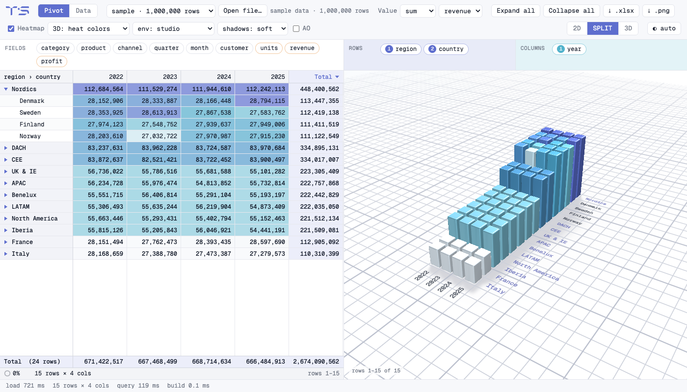

<h1><picture><source media="(prefers-color-scheme: dark)" srcset="docs/logo-dark.svg"></picture></h1>

**ts-pivot**

A fast pivot table that runs entirely in the browser.
**DuckDB-WASM** does the aggregation, a **Canvas 2D** table draws only the visible cells, and **React Three Fiber** shows the same pivot as glossy 3D bars, side by side and linked.

Drop in a CSV, Parquet, JSON or Excel file (or use the built-in 1M-row sample), drag fields into Rows and Columns, and it pivots in a fraction of a second. Nothing leaves your machine.

<picture>
  <source media="(prefers-color-scheme: dark)" srcset="docs/screenshot-dark.png">
  
</picture>

<br>

**Preview**

https://github.com/user-attachments/assets/f069247e-3601-45dc-b52b-aadc3ef37655

---

## Contents

- [Features](#features)
- [Quick start](#quick-start)
- [Using it](#using-it)
- [How it works](#how-it-works)
- [Project structure](#project-structure)
- [Performance](#performance)
- [Troubleshooting](#troubleshooting)
- [Roadmap](#roadmap)
- [Author](#author)
- [Credits](#credits)

---

## Features

**Pivoting**

- Drag-and-drop **Rows / Columns** with reordering, plus **sum, avg, count, min and max** over any numeric field.
- **Row groups with subtotals.** Each row field is a tree level with ▸/▾ carets, _Expand all_ and _Collapse all_. Open groups are remembered when you change the measure.
- **Multi-level column headers** with merged group spans, a **Total** column and a frozen **grand-total row**.
- **Sorting** by clicking a value column, _Total_, or the row-label header. Rows are sorted inside their group, so groups stay together.
- **Select cells by dragging** (or click, then Shift-click). The bar under the table describes the selection (rows × columns, count, sum, avg, min, max), the 3D view plots just those cells, and **✕ Clear** or Esc deselects.
- **Heatmap** colouring per level, so subtotals don't wash out the detail rows.
- One `GROUPING SETS` query computes every level and all the totals. A newer request **cancels** the running query.

**Data**

- Open or drop **CSV/TSV, Parquet, JSON/NDJSON and Excel (.xlsx, .xlsm)** files. Excel files are read in a Web Worker and can have several sheets.
- A built-in **sample dataset** of 100k to 10M rows, generated inside DuckDB.
- **Save the 3D view as an image** (⤓ .png), exactly as on screen.
- **Download as Excel** (⤓ .xlsx): the pivot as shown, with open groups, sort order, merged column headers, frozen labels, bold subtotals and Excel row outlines. Written in a Web Worker, about 6 s for 817k rows.
- A **Data** view of the raw rows: paged out of DuckDB on demand, sortable by any column, fine at millions of rows.

**Rendering**

- **Canvas 2D grids** that draw only what's on screen: frozen headers, themed **scrollbars** drawn on the canvas (over native scrolling, so wheel, trackpad and keys behave as usual), and support for over 16M px of content.
- **3D view** (React Three Fiber): one instanced mesh of **bevelled bars** that keep the same bevel at any height. It has an HDR **studio environment**, a floor that **fades into the background** with a subtle grid, **soft accumulated shadows** (or sharp ones) and optional **N8AO** ambient occlusion.
- **Split view** links the two views: hovering a cell outlines its bar, and hovering a bar outlines its cell. The 3D view follows the rows you've scrolled to, and **Shift + scroll** over the 3D view scrolls the table.
- **Light and dark themes** (auto, light or dark) and the **Geist Mono** font, all bundled, so the app works offline.

---

## Quick start

### Requirements

- [**Bun**](https://bun.sh) 1.1 or newer. Node 20.19+ with npm should also work, but hasn't been tested.
- A recent **Chrome, Edge, Firefox or Safari**, with WebGL2 and WebAssembly (any current browser has both).

### Install and run

```bash
# 1. get the code
git clone <your-repo-url> ts-pivot
cd ts-pivot

# 2. install dependencies
bun install

# 3. start the dev server
bun dev
```

Open **http://localhost:5173**. The first load fetches the DuckDB WebAssembly engine (about 36 MB, served from your own dev server). After that the browser caches it.

<details>
<summary>Using npm instead of Bun</summary>

```bash
npm install
npm run dev
```

</details>

### Scripts

| Command             | What it does                                                     |
| ------------------- | ---------------------------------------------------------------- |
| `bun dev`           | Dev server with hot reload, on `http://localhost:5173`           |
| `bun run build`     | Type-check, then a production build into `dist/`                 |
| `bun run preview`   | Serve the production build locally                               |
| `bun run typecheck` | Type-check only (`tsrs -b`, the Rust port of `tsc`)              |
| `bun run test`      | Run the tests once (Vitest); `bun run test:watch` keeps watching |
| `bun run check`     | Lint, format and import-order check (Biome)                      |
| `bun run check:fix` | Apply Biome's safe fixes and formatting                          |

`dist/` is a static site, so you can host it on any static file server. It needs no special headers.

---

## Using it

| To...                 | Do this                                                                                                                                                                                     |
| --------------------- | ------------------------------------------------------------------------------------------------------------------------------------------------------------------------------------------- |
| Load data             | **Open file…** or drag a file onto the page. Pick a sample size from the first dropdown.                                                                                                    |
| Switch Excel sheet    | Use the **sheet** dropdown that appears for workbooks with more than one sheet.                                                                                                             |
| Build the pivot       | Drag fields from **Fields** into **Rows** / **Columns**, or reorder them. Double-click to add to Rows, or to remove.                                                                        |
| Change what is summed | The **Value** dropdowns (aggregation, then measure).                                                                                                                                        |
| Open or close groups  | Click a ▸/▾ caret, or **Expand all** / **Collapse all**.                                                                                                                                    |
| Select cells          | Drag across cells (dragging past an edge scrolls), or click then Shift-click. Only the selection is plotted in 3D. **✕ Clear** or Esc to deselect.                                          |
| Sort rows             | Click a column header (largest first, smallest first, then off) or the row header (A→Z, Z→A, then off).                                                                                     |
| See raw rows          | Switch **Pivot → Data**. Click any header there to sort.                                                                                                                                    |
| 3D                    | Use **2D / SPLIT / 3D**. Drag to orbit and scroll to zoom. **Shift + scroll** moves through the rows (**Option/Alt + scroll** through the columns, past 120). Hover a bar to see its value. |
| 3D look               | **3D colors** (heat by default, series or white gloss), **env** (studio, sunset, dawn, city, lightformers), **shadows** (soft or sharp) and **AO**.                                         |
| Export to Excel       | **⤓ .xlsx** downloads the pivot as shown (open groups and sort order).                                                                                                                      |
| Save the 3D view      | **⤓ .png** (shown with SPLIT / 3D) downloads the 3D view as an image.                                                                                                                       |
| Theme                 | The **◐ auto / ☀ light / ☾ dark** button. Your choice is remembered.                                                                                                                        |

---

## How it works

```
 file / sample
      │
      ▼
 DuckDB-WASM  (own Web Worker)          one `facts` table
      │  GROUPING SETS: every row level × columns, subtotals, grand total
      ▼
 Arrow result ──▶ typed arrays per row level (+ child offsets)     engine/pivot/pivot.ts
      │
      ▼
 buildDisplay(result, expand, sort) ──▶ visible rows (typed arrays)  engine/pivot/display.ts
      │
      ├──▶ CanvasPivotGrid   Canvas 2D, draws only visible cells     grid/
      │        │ viewport (throttled) + hover
      │        ▼
      └──▶ PivotScene3D     R3F, one InstancedMesh of bars           three/
```

A few rules keep it fast:

- **No React on the hot path.** Scrolling and hovering only redraw the canvas. React re-renders only when data or options change.
- **No per-cell objects.** Values live in `Float64Array`s, and only visible cells are formatted.
- **One draw call for the bars.** Bar heights are an instance attribute. A small vertex-shader patch raises the top half of a drei `RoundedBoxGeometry`, so bevels never stretch. Picking uses a ray-box test per bar.
- **Query cancellation.** Every pivot statement goes through DuckDB's pending-query API (`conn.send`), so `cancelSent()` can stop it part-way.

---

## Project structure

```
ts-pivot/
├── index.html                  Vite entry page
├── package.json                scripts and dependencies
├── tsconfig.json               strict TypeScript settings (checked with tsrs)
├── biome.jsonc                 lint and format rules
├── vite.config.ts              React plugin; keeps duckdb-wasm out of the dep optimizer
├── docs/
│   ├── logo-light.svg          README logo (light and dark variants)
│   ├── logo-dark.svg
│   ├── screenshot-light.png    README screenshots
│   └── screenshot-dark.png
└── src/
    ├── main.tsx                React root, fonts, theme applied before first paint
    ├── App.tsx                 toolbar, state, wiring between engine and views
    ├── styles.css              layout and light/dark design tokens
    │
    ├── engine/                 data and logic (no React, no rendering)
    │   ├── db/
    │   │   ├── duck.ts         DuckDB setup, job queue, cancellable queries, file and sample loading, schema
    │   │   └── raw.ts          Data view: 512-row block paging by rowid, LRU cache, sorting
    │   ├── pivot/
    │   │   ├── pivot.ts        pivot SQL (GROUPING SETS) → typed arrays per row level
    │   │   ├── arrowStrings.ts fast bulk decoding of Arrow string columns (labels)
    │   │   ├── display.ts      expand/collapse state, sorting, flattened visible rows
    │   │   ├── config.ts       default layouts, moving fields between Rows / Columns
    │   │   └── selection.ts    sum / min / max of the selected cells
    │   └── excel/
    │       ├── xlsxImport.ts        small .xlsx reader (fflate + loop-based XML scan)
    │       ├── xlsxImportWorker.ts  Web Worker: workbook → typed Arrow columns → IPC bytes
    │       ├── xlsxExport.ts        pivot → .xlsx writer (streamed XML in a zip) and download
    │       └── xlsxExportWorker.ts  Web Worker that runs the export
    │
    ├── grid/                   Canvas 2D tables (framework-free classes plus thin React wrappers)
    │   ├── core/               shared canvas-grid recipe
    │   │   ├── CanvasGridBase.ts   overlay canvas, native scrolling, >16M px scaling, redraw scheduling
    │   │   ├── scrollbars.ts       canvas-drawn vertical / horizontal scrollbars (drag, track click)
    │   │   ├── bottomBar.ts        scroll wheel, percentage and row range
    │   │   ├── canvasText.ts       pixel snapping and vertical text centring
    │   │   └── gridStyle.ts        fonts, sizes, sort arrow
    │   ├── pivot/
    │   │   ├── CanvasPivotGrid.ts  pivot table: layout, hit testing, hover, sorting, toggling
    │   │   ├── pivotPaint.ts       paints a frame: cells, heatmap, tree column, merged headers, totals
    │   │   ├── dragSelect.ts       cell selection by press / drag / shift-press, edge auto-scroll
    │   │   └── PivotGrid2D.tsx     React wrapper
    │   └── data/
    │       ├── CanvasDataGrid.ts   raw-rows table with sortable headers
    │       └── DataGrid.tsx        React wrapper
    │
    ├── three/                  3D view
    │   ├── PivotScene3D.tsx    canvas, camera, controls, the hint overlay
    │   ├── Bars.tsx            instanced bevelled bars, hover outline, picking, floor, labels
    │   ├── sceneWindow.ts      which rows / columns of the pivot are shown as bars
    │   ├── useWheelScroll.ts   Shift / Alt + wheel scrolls the table from 3D
    │   ├── Capture.tsx         PNG snapshot of the 3D canvas (no preserveDrawingBuffer)
    │   ├── AxisLabels.tsx      row and column labels as one troika BatchedText (one draw call)
    │   ├── Stage.tsx           HDR environment, Lightformers, floor, grid, shadows, N8AO
    │   └── SoftShadows.tsx     accumulated soft floor shadows (after drei AccumulativeShadows)
    │
    ├── hooks/                  App state helpers
    │   ├── usePivotSort.ts     row sort that survives re-queries
    │   ├── useTheme.ts         system / light / dark, remembered
    │   └── useViewportSync.ts  keeps the grid and the 3D view on the same rows
    │
    ├── ui/                     toolbar and status components
    │   ├── FieldZones.tsx      drag-and-drop Fields / Rows / Columns
    │   ├── SourceControls.tsx  sample size, Open file…, Excel sheet
    │   ├── ValueControls.tsx   aggregation and measure
    │   ├── SceneControls.tsx   3D colours, environment, shadows, AO
    │   ├── SelectionBar.tsx    summary of the selected cells
    │   ├── StatusBar.tsx       timings, sizes, hovered cell, errors
    │   └── Logo.tsx            the ts logo (SVG, takes the theme's accent colour)
    │
    ├── theme/
    │   ├── theme.ts            light/dark colours for the canvases and the 3D scene
    │   └── palette.ts          the 9-colour palette, series colours, heat ramp
    │
    ├── lib/
    │   ├── format.ts           number formatting
    │   └── saveBlob.ts         browser download of a Blob
    │
    ├── test/
    │   └── nodeDuck.ts         DuckDB in Node for tests (stands in for engine/db/duck.ts)
    │
    └── types/
        └── troika-three-text.d.ts  typings for the troika classes used
```

Tests sit next to the code they cover (`*.test.ts`) and run with `bun run test`.

### Tech stack

| Area         | Library                                                                           |
| ------------ | --------------------------------------------------------------------------------- |
| UI           | React 19, TypeScript, Vite                                                        |
| Query engine | `@duckdb/duckdb-wasm`, `apache-arrow`                                             |
| 3D           | `three`, `@react-three/fiber`, `@react-three/drei`, `@react-three/postprocessing` |
| Assets       | `@pmndrs/assets` (HDRIs, bundled), `@fontsource/geist-mono`                       |
| Excel        | `fflate` (zip), built-in XML reader                                               |

---

## Performance

Measured in headless Chromium (no GPU) with the 1M-row sample:

| Task                                                     | Time                                                 |
| -------------------------------------------------------- | ---------------------------------------------------- |
| Generate 1M sample rows                                  | about 1.0 s                                          |
| region › country × year › quarter, with subtotals        | 0.3–0.5 s                                            |
| customer (100k rows) × month (48 columns)                | about 0.9 s query + 0.2 s build                      |
| region › country › customer (817k rows) × year › quarter | build 0.42 s (was 1.16 s before bulk label decoding) |
| Cancel a running pivot                                   | about 0.2 s                                          |
| 2D scroll through 100k rows                              | 60 fps                                               |
| Data view: jump to row 500,000 of 1M                     | under 1 s                                            |
| Sort 1M raw rows                                         | about 1–1.6 s                                        |
| 300k-row .xlsx load                                      | about 3.3 s                                          |

DuckDB's step-by-step queries are driven by messages on the main thread, so heavy 3D rendering can slow them down. These timings come from a browser rendering 3D in software, with no GPU. A real GPU should do much better, but that hasn't been measured.

---

## Troubleshooting

| Problem                           | Fix                                                                                                                             |
| --------------------------------- | ------------------------------------------------------------------------------------------------------------------------------- |
| **Blank page**                    | Open the browser console (⌥⌘J or Ctrl+Shift+J) and look for the first red error. Make sure you ran `bun install` after pulling. |
| Old `.xls` file won't open        | Save it as `.xlsx` in Excel or Numbers. Only the modern format is supported.                                                    |
| 3D view is slow                   | Turn off **AO**, or use **2D**. Check that the browser uses hardware acceleration (`chrome://gpu`).                             |
| Fonts look different for a moment | The grid redraws once Geist Mono has loaded. This is expected on first paint.                                                   |

---

## Roadmap

- Subtotals and collapsing for column groups (rows only for now), you can toggle - default is off
- Filters on field values
- The 2D grid in an `OffscreenCanvas` worker

---

## Author

Made by **Darek Nyckowiak** / [typed.systems](https://typed.systems).

---

## Credits

- [DuckDB-WASM](https://github.com/duckdb/duckdb-wasm), [three.js](https://threejs.org), [React Three Fiber](https://github.com/pmndrs/react-three-fiber)
